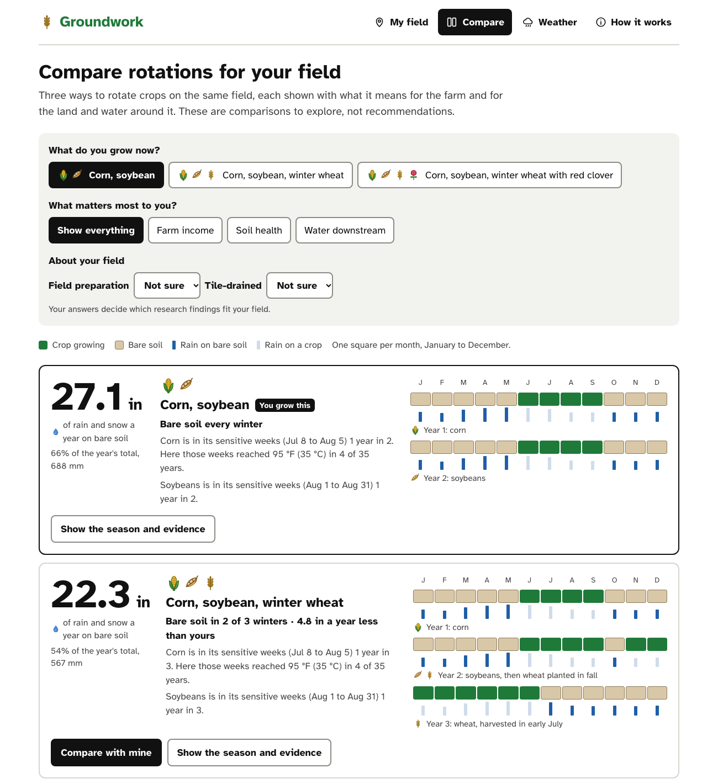

# Groundwork

**Is your soil bare when the rain comes?** Groundwork shows an Ohio farmer how much rain and snow falls on their own field while nothing is growing on it, using NASA data, and compares crop rotations that would keep the soil covered.

**Try it:** https://groundwork-d21p.onrender.com. Press "Use the example field west of Dayton" to skip choosing a location. The free server sleeps when idle, so the first visit can take about a minute to load.

Built for the [NASA Space Apps Challenge 2026](https://www.spaceappschallenge.org/2026/challenges/adapting-farms-with-nasa-data/), challenge "Field Shift: Adapting Farms with NASA Data". Built with help from an AI assistant; see [How AI was used](#how-ai-was-used).



## The problem

Most Ohio cropland grows corn and soybeans. After the fall harvest there is no living crop until late spring, so the field sits bare for about eight months of the year, including April and May, which are among the wettest. That is when soil washes away and nitrate drains into streams and, eventually, Lake Erie and the Gulf of Mexico.

Adding winter wheat or a cover crop keeps the soil covered, but it costs the farm time, money and sometimes corn yield. A farmer weighing that change needs to see both sides for their own field, not an average one.

## What it does

| Page | What the farmer sees |
|---|---|
| **My field** | Pick a field on the map. Groundwork shows the crop grown there every year since 2008 (USDA crop map), guesses the rotation, and shows how green the field was in each of the last five winters, seen by NASA's MODIS satellite. It then shows **bare-soil rain**: the rain and snow that falls on the field in months with no living crop. |
| **Compare** | The farmer's rotation against corn–soybean–wheat and corn–soybean–wheat with red clover. For each: bare-soil rain, which months are bare, how often corn is in its heat-sensitive weeks, and the research findings for the farm and the environment, including costs, risks to check locally and what is not known. |
| **Weather** | The field's average year, an "Is it changing?" comparison of 1991–2007 with 2008–2025 (heavy-rain days, 90 °F days, yearly precipitation), and how corn's and soybeans' sensitive weeks have varied. |
| **How it works** | Data sources and their resolution, how every number is calculated, limits, and the strength of every finding. |

## What makes it different

- **Bare-soil rain.** A simple measure that links NASA climate data to a decision the farmer controls: what to plant and when.
- **The farmer's own field.** Crop history and winter cover come from satellite data for that field, not a county average.
- **Evidence that knows its limits.** Every finding is labelled by how it is known (measured in Ohio, measured in another state, from the crop calendar, or expert guidance). Groundwork checks each trial result against the farmer's answers. For example, a no-till trial result is marked "may not apply" for a tilled field, with the distance to the trial site.
- **No black box.** No score, ranking or yield prediction. Groundwork lays out the evidence; the farmer decides.

## NASA data

| Data | Used for |
|---|---|
| [NASA POWER](https://power.larc.nasa.gov/) daily data (MERRA-2), 1991–2025: precipitation, daily high temperature, root zone soil wetness | Bare-soil rain, sensitive weeks, the Weather page |
| [NASA MODIS MOD13Q1](https://lpdaac.usgs.gov/products/mod13q1v061/) NDVI, 250 m, every 16 days, through the [ORNL DAAC](https://modis.ornl.gov/data/modis_webservice.html) | Winter greenness compared with the field's own summer peak |

Other data: the [USDA NASS Cropland Data Layer](https://www.nass.usda.gov/Research_and_Science/Cropland/SARS1a.php) through CroplandCROS (crop history), and USGS National Map imagery and OpenStreetMap (map images).

## Limits

- Bare-soil rain measures exposure, not runoff, erosion or nutrient loss.
- NASA POWER describes an area about 50 km across and smooths out local storms.
- A 250 m MODIS square can include field edges, roads or trees. Groundwork never says a field had a cover crop: NDVI alone is not enough to tell ([Remote Sensing, 2021](https://doi.org/10.3390/rs13101998)).
- The crop research comes from a few Ohio sites, so Groundwork covers Ohio only.
- Soil type and slope are not included yet.

## Research sources

1. Huo, Frey, Lindsey, Benitez. [Yield and soil responses to adding wheat to a corn-soybean rotation](https://acsess.onlinelibrary.wiley.com/doi/10.1002/cft2.20143). Crop, Forage & Turfgrass Management, 2022.
2. [Benefits of incorporating wheat in a three-crop rotation](https://ocj.com/2020/06/benefits-of-incorporating-wheat-in-a-three-crop-rotation/). Ohio's Country Journal, 2020.
3. [How do cover crops impact field nitrogen and phosphorous losses?](https://agcrops.osu.edu/newsletter/corn-newsletter/24-2021/how-do-cover-crops-impact-field-nitrogen-and-phosphorous-losses) Ohio State University C.O.R.N. Newsletter, 2021.
4. R.L. Nielsen. [Drought and Heat Stress Effects on Corn Pollination](https://www.agry.purdue.edu/ext/corn/pubs/corn-07.htm). Purdue University.
5. [Irrigating Soybean (G1367)](https://extensionpubs.unl.edu/publication/g1367/na/html/view). University of Nebraska-Lincoln Extension.
6. [Crop Progress](https://esmis.nal.usda.gov/sites/default/release-files/795995/prog3026.pdf), reports released July 20 to August 10, 2026. USDA National Agricultural Statistics Service.
7. [Managing Cover Crops Profitably, 3rd edition: Red Clover](https://www.sare.org/publications/managing-cover-crops-profitably/legume-cover-crops/red-clover/). SARE, 2007.

Every finding, its source, its strength and the conditions it was measured under are in [backend/rotations.json](backend/rotations.json).

## How AI was used

This project was built with Claude, an AI assistant made by Anthropic.

Claude helped:

- find and test data services
- write most of the code and tests
- draw the crop icons
- draft page text and this README

The developer reviewed every change, wrote code, came up with ideas, read the research sources, and checked the findings against them.

The app itself uses no AI: everything you see is calculated from the data above or quoted from the sources above.

## Run it locally

You need Python 3.14 and Node 24.

```sh
# Backend, on http://127.0.0.1:8000
cd backend
python -m venv .venv
.venv/bin/pip install -r requirements.txt
.venv/bin/uvicorn main:app --reload

# Frontend, on http://localhost:5173 (in a second terminal)
cd frontend
npm install
npm run dev
```

Tests: `cd backend && .venv/bin/python -m unittest`. Lint: `cd frontend && npm run lint`.

The first lookup of a field downloads its data and saves it in `backend/data/`. Those files are not committed, except for the example fields.

## Deploy

The [Dockerfile](Dockerfile) builds the frontend and serves it from FastAPI, so the site is one service. [render.yaml](render.yaml) deploys it on Render's free tier.

## Project structure

```
backend/
  main.py           API endpoints, and serves the built frontend
  comparison.py     bare-soil rain and sensitive weeks
  weather.py        monthly averages and the 1991–2007 vs 2008–2025 comparison
  evidence.py       checks each finding against the farmer's answers
  nasa_power.py     NASA POWER daily data
  modis.py          MODIS winter greenness
  cropland.py       USDA crop history and rotation guess
  rotations.json    rotations, crop calendars, findings and sources
frontend/src/
  pages/            My field, Compare, Weather, How it works
  compare/          rotation rows, side-by-side view, evidence
docs/PLAN.md        the working plan
```

## Disclaimer

Groundwork was built for the NASA Space Apps Challenge. It is not affiliated with or endorsed by NASA. It supports a farmer's own judgement and local advice and does not replace them.

## License

[MIT](LICENSE)
